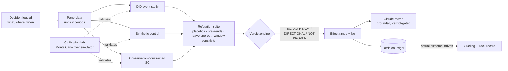

# Decision Proof

**A causal verification layer for business decisions. It proves what actually moved the numbers before anyone asks a board to act on it.**

Forecasts say what will probably happen. Dashboards say what did happen. Neither says *why*, and "why" is what a board needs before it approves the next decision. Decision Proof takes a business decision (a price change, a promotion, a rollout), estimates its causal effect with several methods, tries hard to break each estimate, and only then states a result. The result is always a range, with the lag before it takes effect, and with a verdict on whether it is fit for a board.

Every decision and its predicted range goes into a ledger. When the real outcome arrives, the prediction is graded against it, so the system's track record is measured rather than claimed.

> The core principle: **an estimate that hasn't survived an attempt to refute it is not a result.** Decision Proof is designed to say "not proven" when that is the honest answer.

### Anchor client: a multi-region, publicly-traded drive-thru coffee chain

Modeled on **Dutch Bros Inc. (NYSE: BROS)** — 1,043 shops across 19 states as of Q2 2025, systemwide same-shop sales growth of 6.1% (company-operated: 7.8%), $415.8M quarterly revenue. All figures are public (SEC filings, earnings releases); Decision Proof never touches Dutch Bros' or any client's actual data, only the simulator.

Why this client shape, specifically: **same-store sales (SSS)** is the one number every analyst tears apart on the earnings call, and it's exactly what a market-by-market price test can quietly move in the wrong direction weeks before anyone notices — at a scale (1,000+ shops, dense clusters within a metro) where a price test in some shops measurably shifts customers to untested neighbors, biasing the very "control" group a naive synthetic control relies on. A chain at this stage is big enough for pricing mistakes to be expensive and repeated, but not yet big enough to have an in-house causal inference research org (unlike a marketplace giant such as Airbnb or Uber, who've already built this).

---

## Part 1: The product

### 1.1 Who it is for and what they get

| User | Question they ask | What Decision Proof returns |
|---|---|---|
| VP Pricing & Revenue Strategy (with FP&A) | "We raised prices in a handful of shops ahead of a systemwide rollout — did it move same-store sales, or did we just get lucky?" | SSS effect range (for example +0.8pp to +2.1pp), the lag before it shows up in the comps, a verdict, and a one-paragraph memo |
| Analytics lead | "Which method should I trust here?" | Side-by-side estimates, a refutation report, and which checks passed or failed |
| Growth / expansion team | "If we raise price on shops in these 4 new-state markets, how long until we know it's safe to take systemwide?" | Experiment design: which units to treat and which to use as controls, the minimum detectable effect, and the required duration |
| CEO / board / public-market analysts | "How often has pricing guidance like this held up against what actually showed up in same-store sales?" | Ledger track record: how often actual outcomes fell inside the predicted ranges |

### 1.2 The demo world: Daybreak Coffee (fully simulated, modeled on Dutch Bros' market structure)

Daybreak Coffee is a fictional multi-state drive-thru coffee chain — structurally modeled on Dutch Bros' public footprint, not its data — operating **24 metro markets across multiple US states**, each with several shops. Per shop-cluster per week: same-store sales, transaction count, and average ticket. All data is generated by the simulator in this repo. The true effect of every intervention is known, which is what makes it possible to check the methods for bias, coverage and failure modes.

Shops within the same metro share a customer base, so a price test in some shops can shift transactions to untested shops next door — the cannibalization/spillover dynamic S4 and the conservation-constrained synthetic control exist to catch.

Demo scenarios:

| # | Scenario | What it demonstrates |
|---|---|---|
| S1 | **Price +6% in 4 regions** from week 61, with 60 weeks of history and an effect that ramps up over 3–5 weeks | The full working path: estimate, refute, verdict **BOARD-READY** |
| S2 | **Same decision, 12 weeks of history** | Short-history degradation: synthetic control overfits, intervals widen, verdict drops to **DIRECTIONAL** |
| S3 | **Promo with no true effect, coinciding with a seasonal spike** | The system refuses a false positive: verdict **NOT PROVEN** |
| S4 | **Price rise causes spillover**: some demand shifts to neighbouring regions, contaminating the control units | Standard synthetic control is biased; the conservation-constrained synthetic control corrects for it |
| S5 *(stretch)* | **Staggered rollout** across regions over 8 weeks | Why naive two-way fixed effects is biased under staggered adoption, and the fix |

### 1.3 How a decision moves through the system



### 1.4 Modules

#### M1: Simulator (`simulate/`)
Generates panel data with a known true effect, so every method can be checked against it.

- **What drives the simulated numbers:** a baseline level per region, a shared trend, a seasonal pattern of period 52 with a random phase for each region, noise that carries over week to week (AR(1)), and occasional shocks.
- **Treatment effect:** a size and a ramp-up profile (how long the effect takes to build), with optional differences between regions. Also optional: an effect of zero, spillover into neighbouring control regions, and a conservation constraint (the total across regions is fixed, so a gain in one region is a loss elsewhere).
- **Output:** the panel, plus a ground-truth object containing the true effect path, the true cumulative effect, and which units are treated.
- **Done when:** every scenario S1–S5 can be generated from one seed, and the output is reproducible.

#### M2: Estimators (`estimators/`)
All estimators share one interface: `fit(panel, decision) -> EffectEstimate`.

- **DiD event study.** Separate effect estimates for each week before and after the change, with week −1 as the reference point. With only 4 treated units, ordinary clustered standard errors are unreliable, so use a **wild cluster bootstrap** or randomization inference (pyfixest supports both).
- **Synthetic control.** Donor weights constrained to be non-negative and sum to 1, fitted on the pre-period. Inference via **placebo-in-space** (rank of the post/pre RMSPE ratio) and, ideally, **conformal inference** for synthetic control. With several treated units, fit each one and aggregate.
- **Conservation-constrained synthetic control.** The method from my working paper. It handles donor-pool contamination when demand is conserved across units: when the treated unit gains, donors lose, so a naive synthetic control is biased. This is the main original-methods contribution in the repo.
- *(stretch)* A Bayesian time-series model similar to CausalImpact, as a third independent method.

Every `EffectEstimate` reports:
- the cumulative effect as an absolute number and a percentage, with a 90% interval;
- the effect over time, by week after the change, with intervals;
- **lag summary:** weeks until 50% and 90% of the full effect is reached;
- diagnostics: pre-period fit quality, donor weights, and the leads used in the pre-trend test.

**Done when:** on S1, each estimator's interval contains the true effect and the event study shows the ramp.

#### M3: Refutation suite (`refute/`)
Each check is a function that returns `{name, statistic, threshold, status: PASS|WARN|FAIL, explanation}`.

| Check | Critical? | Logic |
|---|---|---|
| Pre-trend test (DiD) | Yes | Joint test on the pre-change effect estimates; fail if p < 0.10 |
| Synthetic control pre-fit quality | Yes | Pre-period RMSPE relative to the outcome's scale; fail above a threshold |
| Placebo-in-space | Yes | Rank of the treated unit's post/pre RMSPE ratio among all placebo units; pass if rank p ≤ 0.10 |
| Placebo-in-time | Yes | Pretend the change happened at an earlier date; fail if a "significant" effect appears |
| Leave-one-out donors | No | Drop each donor in turn; warn if the sign flips or the effect moves more than 50% |
| Pre-window sensitivity | No | Re-estimate with shorter pre-periods; warn if the estimate is unstable |
| Agreement between methods | No | Warn if the intervals don't overlap |

All thresholds are configurable and documented in `docs/METHODS.md`. They are judgment calls and are labelled as such.

#### M4: Verdict engine (`refute/verdict.py`)
- **BOARD-READY**: every critical check passes, at least two methods agree, and the interval excludes zero.
- **DIRECTIONAL**: critical checks pass, but the interval includes zero or the methods only partly agree.
- **NOT PROVEN**: any critical check fails.

The verdict always comes with plain-English reasons. "Not proven" is a valid product output, not an error state.

#### M5: Calibration lab (`calibrate/`)
This shows whether the 90% intervals deserve to be called 90%.

- Run each method on N = 200 simulated datasets for each scenario, using parallel workers.
- Report: **bias, RMSE, 90% interval coverage, false-positive rate under no effect (S3), and interval width**.
- The output is `docs/LAB_REPORT.md`, a short methods write-up with a coverage chart and a table of where each method breaks. Report the numbers that come out, whatever they are.

**Done when:** a single command regenerates the lab report from scratch.

#### M6: Experiment designer (`design/`)
This answers "If we do X, here's the range, and here's how long to run it."

- **Power by simulation:** inject effects of known size into historical data at random placebo units and dates, re-run the estimator, and record how often the effect is detected. Report the minimum detectable effect at 80% power for a given number of weeks.
- **Choosing treated and control regions:** pick the regions to treat so that each has a well-fitting synthetic control. This follows the idea of synthetic controls for experimental design.
- **Forward-looking range:** for a proposed price change, give a range based on price sensitivity estimated from past changes (the dose-response method from my pricing working paper).

#### M7: Decision ledger and grading (`ledger/`)
- A DuckDB table `decisions` with: id, description, owner, decision date, units, predicted range, method, verdict, and status (open or graded).
- When the actual outcome arrives, re-estimate on the extended window, record the realised effect, and grade: **was it inside the predicted range?** Also record an interval score.
- **Track record view:** the share of graded decisions whose actual outcome fell inside the predicted range, over time. This is how the system's credibility is earned.

#### M8: Claude analyst layer (`agent/`)
Claude explains the results. It does not produce them. Claude calls tools (`list_decisions`, `run_analysis`, `get_refutation_report`, `design_experiment`) and drafts a CFO memo, with three guardrails:

1. **Verdict-gated templates.** A NOT PROVEN verdict can only produce a "we can't yet attribute this, and here's what would settle it" memo.
2. **Numeric grounding check.** Every number in the memo must match a value in the analysis output, within rounding. Otherwise the memo is rejected and regenerated.
3. **Ranges required.** A point estimate is never stated on its own.

Set the model with the `ANTHROPIC_MODEL` environment variable and keep the API key in secrets, never in code.

#### M9: App (`app/`)
A Streamlit app with four pages:
1. **Decisions:** the ledger, with a button for each decision to analyse it.
2. **Evidence:** event study chart, synthetic control fit with donor weights, placebo distribution, and the refutation checklist.
3. **Verdict and memo:** verdict badge, effect range and lag, the Claude memo, and the grounding-check result.
4. **Lab:** calibration results, the experiment designer, and the ledger track record.

### 1.5 Data contracts

```python
class Panel(BaseModel):
    df: DataFrame            # columns: unit_id, period, outcome, [covariates...]
    outcome: str
    period_freq: str = "W"

class Decision(BaseModel):
    decision_id: str
    description: str          # "Price +6% on 4 North regions"
    treated_units: list[str]
    start_period: int
    outcome: str
    owner: str | None = None

class EffectEstimate(BaseModel):
    method: str
    cum_effect: float; cum_lo: float; cum_hi: float      # 90% interval
    pct_effect: float; pct_lo: float; pct_hi: float
    path: list[dict]          # {h, est, lo, hi} per week after the change
    lag_50: int | None; lag_90: int | None
    diagnostics: dict

class RefutationReport(BaseModel):
    checks: list[dict]        # {name, statistic, threshold, status, explanation, critical}
    verdict: Literal["BOARD_READY", "DIRECTIONAL", "NOT_PROVEN"]
    reasons: list[str]
```

### 1.6 Tech stack
Python 3.11 · uv · numpy / pandas · statsmodels · **pyfixest** (event study and wild bootstrap) · scipy or cvxpy (synthetic control weights) · joblib (parallel calibration) · **DuckDB** (ledger) · **Streamlit + Plotly** (app) · **Anthropic SDK** (Claude tool use) · pytest.
*Stretch:* run the calibration lab as a Databricks Free Edition job and store the ledger in Delta tables.

### 1.7 Repository layout
```
decision-proof/
├── README.md
├── CLAUDE.md                     # conventions for Claude Code
├── pyproject.toml
├── src/decision_proof/
│   ├── contracts.py
│   ├── simulate/      dgp.py, scenarios.py
│   ├── estimators/    base.py, did.py, synth.py, synth_conservation.py
│   ├── refute/        checks.py, verdict.py
│   ├── calibrate/     harness.py, report.py
│   ├── design/        power.py, selection.py
│   ├── ledger/        store.py, grading.py
│   ├── agent/         tools.py, memo.py, grounding.py
│   └── app/           Home.py, pages/
├── tests/             test_simulator.py, test_estimators.py, test_refute.py, test_grounding.py
└── docs/              METHODS.md, LAB_REPORT.md
```

### 1.8 Quickstart
```bash
uv sync
uv run pytest
uv run python -m decision_proof.calibrate.harness --n 200   # writes docs/LAB_REPORT.md
export ANTHROPIC_API_KEY=...  ANTHROPIC_MODEL=...
uv run streamlit run src/decision_proof/app/Home.py
```

### 1.9 Honest limitations
- All data is simulated. Real client data will be messier: missing weeks, definitions that change, units entering and leaving.
- The verdict thresholds are informed defaults, not universal truths.
- Synthetic control assumes the treated unit lies within the range of the donors. With few or contaminated donors, the lab report shows where that breaks.
- Grading predictions only works once enough decisions have outcomes, so the track record starts thin.

---

## Part 2: Build and delivery plan (internal; move to `docs/BUILD_PLAN.md` before sharing the repo)

### 2.1 Ground rules
- **Only simulated data and my own genericized papers.** No employer data, code, queries or schemas.
- Build on my own laptop, my own time and my own accounts.
- Private GitHub repo; give the CTO access on request.

### 2.2 Scope tiers (cut from the bottom, never from the top)

| Tier | Includes | Why it matters |
|---|---|---|
| **MUST** | M1 simulator, M2 DiD + synthetic control, M3 refutation, M4 verdict, M5 calibration (S1–S4), M9 Evidence and Verdict pages, M8 memo with grounding check | This is the story: estimate, then refute, then make an honest claim |
| **SHOULD** | Conservation-constrained synthetic control, M7 ledger and grading, Lab page, METHODS.md | My original method, plus the attribution and grading bullet in the JD |
| **NICE** | M6 experiment designer, S5 staggered rollout, Bayesian time-series estimator | Covers "design experiments with clients" |
| **STRETCH** | Databricks job, FastAPI, public deployment | Signals only |

### 2.3 Time blocks (about 26 focused hours)

| Block | Hours | Deliverable | Exit test |
|---|---|---|---|
| 0. Setup | 1 | Repo, uv, contracts.py, CLAUDE.md, CI with pytest | `uv run pytest` passes on empty tests |
| 1. Simulator | 3 | DGP + scenarios S1–S4 + ground truth | Plot S1: ramp visible, seeds reproducible |
| 2. Estimators | 4 | DiD event study (wild bootstrap) + synthetic control (placebo inference) | S1 intervals contain the true effect |
| 3. Refutation + verdict | 3 | All checks + verdict rules | S1 = BOARD-READY, S2 = DIRECTIONAL, S3 = NOT PROVEN |
| 4. Calibration lab | 3 | Harness + LAB_REPORT.md | Coverage table generated; **start the long run in the background before Block 5** |
| 5. Conservation-constrained SC + ledger | 3 | Contamination-aware estimator, DuckDB ledger, grading | S4: bias reduced versus plain synthetic control (whatever the lab shows) |
| 6. Claude layer | 3 | Tools, verdict-gated memo, grounding check | A memo with an invented number is rejected in a test |
| 7. Streamlit app | 4 | 4 pages, clean charts | Full demo click-through with no errors |
| 8. Polish + backup | 2 | README, METHODS.md, a recorded 5-minute walkthrough as backup | Fresh clone + quickstart works |

**Feature freeze: Monday 10 pm.** Tuesday morning is for rehearsal only, no new code. Sleep before the interview. The live causal assessment is the real test, and a tired version of me will do worse on it than a smaller demo would cost.

### 2.4 Working with Claude Code
- Put this README in the repo first and tell Claude Code to treat it as the spec.
- Build one module at a time: **tests first** (for example "write tests that S1 estimates contain the truth"), then the implementation.
- Keep `CLAUDE.md` short: Python 3.11, type hints, pydantic contracts, no notebooks in `src/`, every estimator returns `EffectEstimate`, no network calls outside `agent/`.
- Read and understand every line I merge. The JD says "you own every line," and I will be asked about the internals.

### 2.5 Demo script (5–7 minutes)
1. **Framing (30 s):** "AI recommendations stall at the board because nobody can defend the cause. This is a small version of the causal layer: estimate, refute, then claim."
2. **S1 (90 s):** Daybreak Coffee price +6%. Event study with the ramp, synthetic control fit, effect range with lag. Verdict: BOARD-READY.
3. **Where it breaks (90 s):** the same decision with 12 weeks of history drops to DIRECTIONAL, with the reasons shown. Then S3: a seasonal spike with no true effect is NOT PROVEN. *"Saying no is the feature."*
4. **The lab (60 s):** coverage table and the S4 contamination result with the conservation-constrained synthetic control. "This is how I'd hold the lab's methods to a standard."
5. **Claude memo (45 s):** the CFO paragraph, plus the grounding check rejecting an invented number.
6. **Ledger (30 s):** the predicted range now, graded when the outcome lands.
7. **Close (30 s):** what I'd do in the first 90 days at Unloq (below).

### 2.6 How the prototype maps to the JD

| JD line | Where it shows up |
|---|---|
| Map drivers, estimate effects from natural experiments, refute every estimate | M2 + M3 + M4 |
| Return effects as honest ranges, with how much and what lag | `EffectEstimate` intervals + `lag_50`/`lag_90` + M5 coverage |
| Design experiments with clients ("if we do X, here's the range") | M6 |
| Own the attribution method; grade each call against what really happened | M7 |
| Raise the bar on evaluation; write up the lab's methods | M5 + LAB_REPORT.md + METHODS.md |
| Real LLM depth: tool use beyond a demo | M8 tool use + grounding check + verdict gating |
| Explain cause and effect to a CFO | Memo + verdict reasons |
| Knows when each method breaks on short histories | S2 + window-sensitivity check + lab |

### 2.7 First-90-days talking points
1. **Weeks 1–4:** audit what clients' data actually looks like (history length, granularity, how much contamination), and set a minimum data standard for each method.
2. **Weeks 4–8:** ship the refutation and verdict layer behind the prescriptive engine, so nothing goes out to a client without passing it.
3. **Weeks 8–12:** start the decision ledger with live clients, publish the first internal methods note, and design the first client experiment.

### 2.8 Interview-day checklist
- [ ] Fresh clone + quickstart tested on a clean environment
- [ ] App runs locally; backup recording ready if the screen-share fails
- [ ] Lab report numbers memorised, especially where each method fails
- [ ] Able to explain the wild bootstrap, placebo inference and the conservation constraint without notes
- [ ] Revision done on the gaps: uplift/CATE meta-learners, MMM (adstock and saturation), power/MDE, CUPED
- [ ] Questions for the CTO ready: runway, client data reality, team, equity, publishing rights
