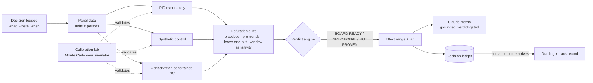

# Decision Proof

**A causal verification layer for business decisions. It proves what actually moved the numbers before anyone asks a board to act on it.**

Forecasts say what will probably happen. Dashboards say what did happen. Neither says *why*, and "why" is what a board needs before it approves the next decision. Decision Proof takes a business decision (a price change, a promotion, a rollout), estimates its causal effect with several methods, tries hard to break each estimate, and only then states a result. The result is always a range, with the lag before it takes effect, and with a verdict on whether it is fit for a board.

Every decision and its predicted range goes into a ledger. When the real outcome arrives, the prediction is graded against it, so the system's track record is measured rather than claimed.

> The core principle: **an estimate that hasn't survived an attempt to refute it is not a result.** Decision Proof is designed to say "not proven" when that is the honest answer.

### Anchor client: a multi-region, publicly-traded drive-thru coffee chain

Modeled on **Dutch Bros Inc. (NYSE: BROS)** — 1,043 shops across 19 states as of Q2 2025, systemwide same-shop sales growth of 6.1% (company-operated: 7.8%), $415.8M quarterly revenue. All figures are public (SEC filings, earnings releases); Decision Proof never touches Dutch Bros' or any client's actual data, only the simulator.

Why this client shape, specifically: **same-store sales (SSS)** is the one number every analyst tears apart on the earnings call, and it's exactly what a market-by-market price test can quietly move in the wrong direction weeks before anyone notices — at a scale (1,000+ shops, dense clusters within a metro) where a price test in some shops measurably shifts customers to untested neighbors, biasing the very "control" group a naive synthetic control relies on. A chain at this stage is big enough for pricing mistakes to be expensive and repeated, but not yet big enough to have an in-house causal inference research org (unlike a marketplace giant such as Airbnb or Uber, who've already built this).

---

## Who it's for and what they get

| User | Question they ask | What Decision Proof returns |
|---|---|---|
| VP Pricing & Revenue Strategy (with FP&A) | "We raised prices in a handful of shops ahead of a systemwide rollout — did it move same-store sales, or did we just get lucky?" | SSS effect range, the lag before it shows up in the comps, a verdict, and a one-paragraph memo |
| Analytics lead | "Which method should I trust here?" | Side-by-side estimates, a refutation report, and which checks passed or failed |
| Growth / expansion team | "If we raise price on shops in these 4 new-state markets, how long until we know it's safe to take systemwide?" | A price-sensitivity range fitted across a batch of same-quarter experiments at different price points |
| CEO / board / public-market analysts | "How often has pricing guidance like this held up against what actually showed up in same-store sales?" | Ledger track record: how often actual outcomes fell inside the predicted ranges |

## The demo world: Daybreak Coffee

Daybreak Coffee is a fictional multi-state drive-thru coffee chain — structurally modeled on Dutch Bros' public footprint, not its data. It shows up in three layers, each exercising a different part of the product:

**1. The core demo (scenarios S1–S5).** 24 metro markets, each with several shops. Per shop-cluster per week: same-store sales, transaction count, and average ticket. The true effect of every intervention is known, which is what makes it possible to check the methods for bias, coverage and failure modes. Shops within the same metro share a customer base, so a price test in some shops can shift transactions to untested shops next door — the cannibalization/spillover dynamic S4 and the conservation-constrained synthetic control exist to catch.

| # | Scenario | What it demonstrates |
|---|---|---|
| S1 | Price +6% in 4 metros, 60 weeks of history, effect ramps over 4 weeks | The full working path: estimate, refute, verdict **BOARD-READY** |
| S2 | Same decision, 12 weeks of history | Short-history degradation — lands **NOT_PROVEN**, not the originally-hoped DIRECTIONAL (see "Honest findings" below) |
| S3 | Promo with no true effect, timed to a seasonal spike | The system refuses a false positive: verdict **NOT PROVEN** |
| S4 | Price +10%, elastic demand (net revenue-negative), with spillover into a neighboring donor | Naive synthetic control is biased; the conservation-constrained synthetic control reduces that bias ~77% |
| S5 | Staggered rollout across 6 metros over 8 weeks | Naive two-way fixed effects vs. a staggered-adoption-robust estimator (see "Honest findings") |

**2. Quarterly Pricing.** Instead of one-off decisions, Daybreak runs a *batch* of price experiments every quarter — four simultaneous tests at different magnitudes (+3%/+6%/+9%/+12%), each on its own metro group, plus a demographic tag (age band, income tier) per metro. Pick one quarter or several; experiments that pass refutation get pooled into a fitted price-sensitivity curve (how much revenue moves per percentage point of price change), and picking more quarters visibly tightens the estimate.

**3. Advanced Methods.** Real pricing decisions don't always fit the estimate → refute → verdict shape S1–S5 use. Six more situations, each with the causal technique it actually calls for:

| Situation | Technique | Headline result |
|---|---|---|
| Staggered multi-wave rollout, effect size growing wave over wave | Staggered-adoption DiD (simplified Callaway & Sant'Anna) | Honest negative: didn't beat naive TWFE at this scale (120-seed comparison) — see "Honest findings" |
| Loyalty-tier price threshold | Regression discontinuity | Recovers the true $12 jump cleanly; all 4 placebo cutoffs correctly null |
| Coffee bean cost shock moves price, unrelated to local demand | Instrumental variables (2SLS) | Naive OLS: 0% coverage across 60 seeds (confidently wrong). 2SLS: 90% coverage |
| True randomized in-app price test | RCT + CUPED | 44% predicted variance reduction → 25.7% observed CI-width reduction, matching theory |
| Same randomized test, effect varies by customer loyalty | Uplift / CATE (T-learner) | Unbiased slope recovery (0.0796 vs. true 0.08); correctly ranks segments by price sensitivity |
| Price + promo spend together, with carryover and diminishing returns | Marketing mix model (adstock/saturation) | Grid search finds the true decay exactly in 34/40 seeds |

## How a decision moves through the system



The six Advanced Methods situations (regression discontinuity, IV, RCT+CUPED, uplift, MMM, staggered DiD) are genuinely different data shapes — customer-level, cross-sectional, aggregate time series — so they don't all route through this exact pipeline; each has its own estimator and its own validation, documented in `docs/METHODS.md`.

## Modules

#### Simulator (`simulate/`)
Generates panel data with a known true effect, so every method can be checked against it. `dgp.py` + `scenarios.py` build the core S1–S5 world; `quarterly.py` builds the multi-experiment quarterly world with demographics; `rdd.py`, `iv.py`, `rct.py`, `uplift.py`, `mmm.py` each build the customer-level or cross-sectional data their technique needs.

#### Estimators (`estimators/`)
The panel-based estimators share one interface: `fit(panel, decision) -> EffectEstimate`.

- **DiD event study** (`did.py`). Wild cluster bootstrap for the headline interval, since ordinary clustered SEs are unreliable with only a handful of treated clusters.
- **Synthetic control** (`synth.py`). Non-negative, sum-to-1 donor weights; placebo-in-space inference (Fisher's method to combine across treated units).
- **Conservation-constrained synthetic control** (`synth_conservation.py`). The original-methods contribution: decontaminates a demand-conserving neighbor's post-period values (replaces them with its own synthetic estimate) before using it as a donor, rather than excluding it outright (tested and rejected — see `docs/METHODS.md`).
- **Staggered-adoption DiD** (`staggered_did.py`). A simplified Callaway & Sant'Anna estimator — never compares a treated unit to another treated unit.
- **Regression discontinuity** (`rdd.py`), **instrumental variables / 2SLS** (`iv.py`), **RCT + CUPED** (`rct.py`), **uplift / CATE T-learner** (`uplift.py`), **marketing mix model** (`mmm.py`) — each with its own result type, since forcing a local RDD effect or a CATE curve into `EffectEstimate`'s cumulative-dollar-range shape would misstate what the number means.

**Done when:** on S1, each panel-based estimator's interval contains the true effect and the event study shows the ramp. ✓

#### Refutation suite (`refute/`)
Each check is a function that returns `{name, statistic, threshold, status: PASS|WARN|FAIL, explanation}`.

| Check | Critical? | Logic |
|---|---|---|
| Pre-trend test (DiD) | Yes | Joint test on the pre-change effect estimates; fail if p < 0.10 |
| Synthetic control pre-fit quality | Yes | Pre-period RMSPE relative to the outcome's scale; fail above a threshold |
| Placebo-in-space | Yes | Fisher-combined rank p-value across treated units; pass if p ≤ 0.10 |
| Placebo-in-time | Yes | Pretend the change happened at an earlier date; fail if a "significant" effect appears |
| Leave-one-out donors | No | Drop each donor in turn; warn if the sign flips or the effect moves more than 50% |
| Pre-window sensitivity | No | Re-estimate with shorter pre-periods; warn if the estimate is unstable |
| Agreement between methods | No | Warn if the intervals don't overlap |

All thresholds are configurable and documented in `docs/METHODS.md`. They are judgment calls and are labelled as such.

#### Verdict engine (`refute/verdict.py`)
- **BOARD-READY**: every critical check passes, at least two methods agree, and the interval excludes zero.
- **DIRECTIONAL**: critical checks pass, but the interval includes zero or the methods only partly agree.
- **NOT PROVEN**: any critical check fails.

The verdict always comes with plain-English reasons. "Not proven" is a valid product output, not an error state.

#### Calibration lab (`calibrate/`)
Shows whether the 90% intervals deserve to be called 90%. Runs each method on N=200 simulated datasets per scenario, in parallel, and reports bias, RMSE, 90% coverage, false-positive rate under no effect (S3), and interval width. Output is `docs/LAB_REPORT.md` — numbers reported as they come out, never tuned to look good.

**Done when:** a single command (`uv run python -m decision_proof.calibrate.harness --n 200`) regenerates the lab report from scratch. ✓

#### Price sensitivity / experiment design (`design/`)
`sensitivity.py` fits the quarterly dose-response curve described above. A fuller power-by-simulation experiment designer (inject known effects, measure detection rate) was scoped as nice-to-have and not built; the Advanced Methods / Verdict pages' lightweight minimum-detectable-effect calculator covers the everyday version of that question.

#### Decision ledger and grading (`ledger/`)
A DuckDB table `decisions`: id, description, owner, decision date, units, predicted range, method, verdict, status (open or graded). When the actual outcome arrives, re-estimates on the extended window (there's no true counterfactual even after the fact — a matured re-estimate is the best available proxy), records the realized effect, and grades: was it inside the predicted range? Also records an interval score (Gneiting & Raftery's proper scoring rule). The track record — share of graded decisions whose actual outcome fell inside the predicted range — is how the system's credibility is earned.

#### Claude analyst layer (`agent/`)
Claude explains the results. It does not produce them. Tools: `list_decisions`, `run_analysis`, `get_refutation_report`, `design_experiment`. Three guardrails on the memo:

1. **Verdict-gated templates.** A NOT PROVEN verdict can only produce a "we can't yet attribute this, and here's what would settle it" memo — a structurally different system prompt, not the same prompt asked nicely.
2. **Numeric grounding check.** Every number in the memo must match a value in the analysis output, within rounding. A memo that fails is rejected and retried (up to 3 attempts), not shipped.
3. **Ranges required.** A point estimate is never stated on its own.

Model via `ANTHROPIC_MODEL`; API key read directly by the SDK from `ANTHROPIC_API_KEY`, never passed or logged. `agent/memo.py` is the only module in the codebase that makes a network call.

#### App (`app/`)
A Streamlit app with six pages:
1. **Decisions** — the ledger, with a button per decision to analyze it.
2. **Evidence** — event study chart, synthetic control fit with donor weights, placebo distribution, refutation checklist.
3. **Verdict and memo** — verdict badge, effect range and lag, the Claude memo, grounding-check result.
4. **Lab** — calibration results, experiment designer, ledger track record.
5. **Quarterly Pricing** — the quarter picker and pooled price-sensitivity curve.
6. **Advanced Methods** — all six Q5–Q10 situations, each with its own chart.

## Honest findings

Calibration and live testing surfaced several real results, reported as they came out rather than tuned to look better (see `docs/METHODS.md` for the full detail on each):

- **S2 (12-week history) lands NOT_PROVEN**, not the originally-scripted DIRECTIONAL. With 20 donors and only 12 pre-period points, synthetic control is underdetermined for every unit, real and placebo alike, which erases the signal placebo-in-space needs.
- **Conservation-constrained synthetic control**: a first attempt (exclude the contaminated donor entirely) was tested and *rejected* — it made bias worse. The kept design (decontaminate rather than exclude) reduces S4's bias ~77%, at the cost of worse interval coverage, itself disclosed rather than hidden.
- **Staggered-adoption DiD did not beat naive TWFE** on a 120-seed comparison, even on a scenario built specifically to expose the bias it's meant to fix. Two smaller samples (40 and 60 seeds) had each suggested the opposite in both directions before the larger, more reliable run settled it.
- **Instrumental variables**: first calibration had a first-stage F-statistic of 1.3 — a severely weak instrument — caught before trusting a result that only "worked" because its interval was too wide to be informative. Recalibrated to F≈826; naive OLS then covers the true effect 0% of the time across 60 seeds (confidently wrong), 2SLS covers it 90%.
- Synthetic control assumes the treated unit lies within the range of the donors; with few or contaminated donors, `docs/LAB_REPORT.md` shows where that breaks.
- All data is simulated. Real client data will be messier: missing weeks, definitions that change, units entering and leaving.
- Verdict thresholds are informed defaults, not universal truths.
- Grading only works once enough decisions have outcomes, so the ledger's track record starts thin.

## Data contracts

```python
class Panel(BaseModel):
    df: DataFrame            # columns: unit_id, period, outcome, [covariates...]
    outcome: str
    period_freq: str = "W"

class Decision(BaseModel):
    decision_id: str
    description: str
    treated_units: list[str]
    start_period: int
    outcome: str
    owner: str | None = None

class EffectEstimate(BaseModel):
    method: str
    cum_effect: float; cum_lo: float; cum_hi: float      # 90% interval
    pct_effect: float; pct_lo: float; pct_hi: float
    path: list[dict]          # {h, est, lo, hi} per week after the change
    lag_50: int | None; lag_90: int | None
    diagnostics: dict

class RefutationReport(BaseModel):
    checks: list[dict]        # {name, statistic, threshold, status, explanation, critical}
    verdict: Literal["BOARD_READY", "DIRECTIONAL", "NOT_PROVEN"]
    reasons: list[str]
```

The Advanced Methods estimators (RDD, IV, RCT/CUPED, uplift, MMM) each return their own lightweight result type instead of `EffectEstimate` — an RDD jump-at-a-cutoff or a CATE-by-segment isn't a cumulative dollar range over a post-period, and forcing it into that shape would misstate what the number means.

## Tech stack
Python 3.11 · uv · numpy / pandas · statsmodels · **pyfixest** (event study + wild bootstrap, via `wildboottest`) · scipy / cvxpy (synthetic control weights, CLARABEL solver) · joblib (parallel calibration) · matplotlib (lab report chart) · **DuckDB** (ledger) · **Streamlit + Plotly** (app) · **Anthropic SDK** (Claude tool use) · pytest.

## Repository layout
```
decision-proof/
├── README.md
├── CLAUDE.md                     # conventions for Claude Code
├── pyproject.toml
├── src/decision_proof/
│   ├── contracts.py
│   ├── simulate/      dgp.py, scenarios.py, quarterly.py, rdd.py, iv.py, rct.py, uplift.py, mmm.py
│   ├── estimators/    base.py, did.py, synth.py, synth_conservation.py, staggered_did.py,
│   │                  rdd.py, iv.py, rct.py, uplift.py, mmm.py
│   ├── refute/        checks.py, verdict.py
│   ├── calibrate/     harness.py, report.py
│   ├── design/        sensitivity.py
│   ├── ledger/        store.py, grading.py
│   ├── agent/         tools.py, memo.py, grounding.py
│   └── app/           Home.py, common.py, quarterly_common.py, methods_common.py, pages/
├── tests/             one file per module above (18 files)
└── docs/              METHODS.md, LAB_REPORT.md
```

## Quickstart
```bash
uv sync
uv run pytest
uv run python -m decision_proof.calibrate.harness --n 200   # writes docs/LAB_REPORT.md
export ANTHROPIC_API_KEY=...  ANTHROPIC_MODEL=...            # optional, for the Claude memo
uv run streamlit run src/decision_proof/app/Home.py
```
