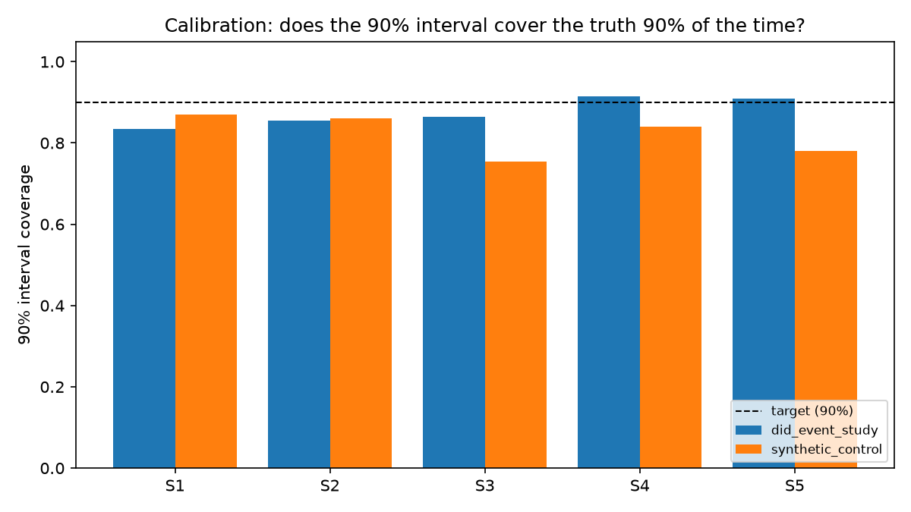

# Lab report

200 replications per scenario per method, 2000 total fits, 56s wall clock.
Regenerate with `uv run python -m decision_proof.calibrate.harness --n 200`.

Numbers below are whatever the harness produced on this run — not tuned to hit a target.

## Coverage, bias, RMSE, interval width

| Scenario | Method | n | Avg true effect | Bias | RMSE | 90% coverage | Avg interval width | Significant rate |
|---|---|---|---|---|---|---|---|---|
| S1 | did_event_study | 200 | $165,541 | $-26,322 | $139,174 | 84% | $547,782 | 23% |
| S1 | synthetic_control | 200 | $165,541 | $2,135 | $116,039 | 87% | $348,389 | 58% |
| S2 | did_event_study | 200 | $165,541 | $-32,682 | $227,730 | 86% | $911,216 | 17% |
| S2 | synthetic_control | 200 | $165,541 | $4,611 | $213,280 | 86% | $713,475 | 30% |
| S3 | did_event_study | 200 | $0 | $13,036 | $139,249 | 86% | $532,079 | 14% |
| S3 | synthetic_control | 200 | $0 | $47,116 | $178,850 | 76% | $470,860 | 24% |
| S4 | did_event_study | 200 | $101,763 | $-21,909 | $140,142 | 92% | $557,471 | 13% |
| S4 | synthetic_control | 200 | $101,763 | $-7,366 | $116,105 | 84% | $350,046 | 34% |
| S5 | did_event_study | 200 | $216,371 | $3,885 | $176,805 | 91% | $652,225 | 29% |
| S5 | synthetic_control | 200 | $216,371 | $22,615 | $158,950 | 78% | $448,789 | 64% |

## Where each method breaks

**S1**: Price +6%, 60 weeks of history. The clean case.
- did_event_study: 84% coverage (target 90%), bias $-26,322, power (detected as significant) 23%
- synthetic_control: 87% coverage (target 90%), bias $2,135, power (detected as significant) 58%

**S2**: Same decision, 12 weeks of history. Short-history degradation.
- did_event_study: 86% coverage (target 90%), bias $-32,682, power (detected as significant) 17%
- synthetic_control: 86% coverage (target 90%), bias $4,611, power (detected as significant) 30%

**S3**: No true effect, timed to a seasonal spike. True effect is 0 — `significant_rate` here *is* the false-positive rate.
- did_event_study: false-positive rate 14% (found a 'significant' effect when the true effect is $0)
- synthetic_control: false-positive rate 24% (found a 'significant' effect when the true effect is $0)

**S4**: Price +7% with spillover into a neighboring donor. Naive synthetic control is expected to be biased here.
- did_event_study: 92% coverage (target 90%), bias $-21,909, power (detected as significant) 13%
- synthetic_control: 84% coverage (target 90%), bias $-7,366, power (detected as significant) 34%

**S5**: Staggered rollout across 6 metros over 8 weeks.
- did_event_study: 91% coverage (target 90%), bias $3,885, power (detected as significant) 29%
- synthetic_control: 78% coverage (target 90%), bias $22,615, power (detected as significant) 64%

